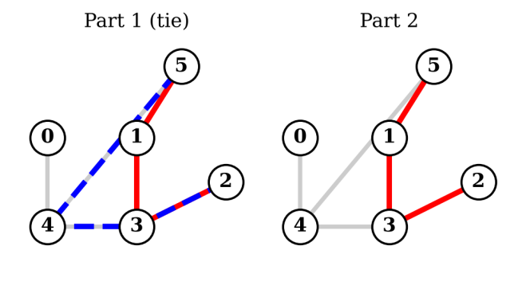
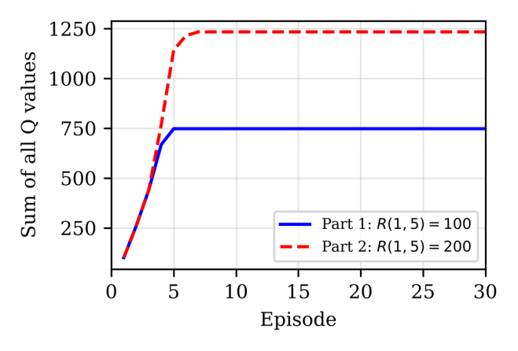

# Robot Navigation with Q-Learning

Tabular Q-learning in MATLAB that teaches a robot to find its way out of a building of five connected rooms, and a study of how reward design changes the path it learns.

*MTRE 4820 – Machine Learning for Robot Perception, Kennesaw State University (Fall 2026)*



## The problem

Rooms 0–4 are connected by two-way doors; room 5 is the outside (the goal). The robot starts in a random room and moves through doors at random, learning the value of each move from the rewards it receives.

| Setting | Value |
|---|---|
| States | Rooms 0–5 (room 5 = goal, absorbing) |
| Doors | 0–4, 1–3, 1–5, 2–3, 3–4, 4–5 |
| Discount factor γ | 0.8 |
| Learning rate α | 1 |
| Part 1 | Reward 100 for every move into room 5 |
| Part 2 | Reward for room 1 → room 5 raised to 200 |

Update rule:

```
Q(s,a) = (1 − α)·Q(s,a) + α·[ R(s,a) + γ · max Q(s',a') ]
```

## Results

**Part 1:** two equally good 3-move routes from room 2: `2 → 3 → 1 → 5` and `2 → 3 → 4 → 5`.

**Part 2:** the higher reward breaks the tie, and `2 → 3 → 1 → 5` becomes the only optimal route. It also makes rooms 4 and 0 skip their direct exit and take a longer detour through room 1, because 200·γ² = 128 > 100. Any R(1,5) above 156.25 causes this.

**Takeaway:** Q-learning maximizes total discounted reward, not path length, so the reward function and γ have to match the behavior you actually want.



## Implementation highlights

- **Reproducible:** fixed random seed (`rng(4820)`)
- **Automatic convergence check:** training stops once Q is unchanged for 100 consecutive episodes, instead of an arbitrary episode count
- **Tie-aware path search:** every action that ties for max Q is followed, so equally good routes are all reported
- Reward matrix built from a simple list of doors (`buildR`), so the floor plan is easy to change

## Run it

Open MATLAB in this folder and run:

```matlab
Project7_QLearning
```

It prints the reward matrices, the Q matrix after the first three episodes, the final Q matrices, the optimal path(s), and plots the convergence curve and the floor-plan paths.

## Files

| File | Description |
|---|---|
| `Project7_QLearning.m` | MATLAB implementation |
| `Project7_Report_Jenn_Price.pdf` | Full project report (IEEE format) |
| `figures/` | Convergence plot and optimal-path diagram |
